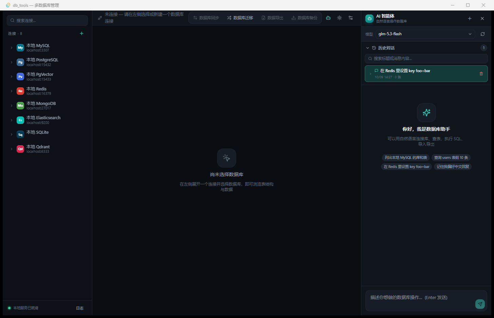

# AgentDB

[中文文档](./README.md) | **English**

> **Agent for Any Database** — let an agent drive every database you have.

A desktop multi-database management tool built with **Tauri 2 + React 19**, with a light/dark theme, an animation system that respects `prefers-reduced-motion`, and a built-in AI agent that can operate the databases through tool calls.

## Interface at a glance



Three regions on first launch: the left sidebar lists connections (expandable to databases and tables, with a search box on top), the header carries the four cross-database tools — sync, migration, export, backup — which stay disabled with an explanatory tooltip until their precondition is met, and the right panel is the AI agent (model switcher, conversation history, suggested prompts). The centre pane shows what to do next when nothing is selected.

## Documentation

Topic guides live in [`docs/`](./docs/README.md) and are written in Chinese (this file is the English entry point):

| Guide | Covers |
| --- | --- |
| [01 Quick start](docs/guide/01-quick-start.md) | install, dev run, UI regions, shortcuts, logs |
| [02 Connections](docs/guide/02-connections.md) | categorized connection picker, testing, connect timeout |
| [03 Browsing and data](docs/guide/03-browse-and-data.md) | object tree, paged grid, filter and sort builder, insert / edit / delete with server echo |
| [04 Structure design](docs/guide/04-structure-design.md) | database designer, visual table creation, columns / indexes / foreign keys |
| [05 Non-relational engines](docs/guide/05-non-sql-engines.md) | Redis commands, ES / Qdrant REST, Mongo queries, operation presets |
| [06 Sync and migration](docs/guide/06-sync-and-migration.md) | cross-engine sync, MySQL↔PostgreSQL migration, per-table reports |
| [07 Export and backup](docs/guide/07-export-mask-backup.md) | CSV / Excel export, column masking rules, SQL dump |
| [08 AI agent](docs/guide/08-ai-agent.md) | model profiles with one default, per-conversation database scope, image questions, tools, memory |
| [09 Appearance](docs/guide/09-appearance.md) | theme, single global font setting, motion and status feedback |

## Supported databases

| Engine | How it is used here |
| --- | --- |
| MySQL | SQL browsing, structure editing, sync / migration / backup |
| PostgreSQL, PgVector | Same as MySQL, plus database designer with `COMMENT`, locale and extension management |
| SQLite | File-based database, structure and data editing |
| Redis | Commands instead of SQL (`GET`, `HGETALL`, `KEYS <pattern>`, …); logical DB routing via `SELECT n` |
| MongoDB | Query documents (`collection\|{filter}`) and run commands (`db.<database>.{json}`) |
| Elasticsearch | Native REST (`METHOD /path [json]`), mapping management — no SQL emulation layer |
| Qdrant | Native REST over the collections API |

Nothing is pre-configured: every connection is one you add yourself, and choosing an engine type just prefills that engine's standard default port.

## Features

### Browsing and structure

- Connection manager with a categorized picker (relational / document / key-value / search / vector), search, recently used types, and connection testing.
- Databases, tables, columns, indexes and foreign keys; per-engine structure pages only expose operations the engine really supports (e.g. SQLite cannot `ALTER ADD FOREIGN KEY`, Elasticsearch cannot change an existing field type — the UI says so and offers the workable alternative).
- Visual table designer, database designer (charset / collation / comment / PG extensions) and column editing with type pickers, index and foreign-key management.
- Data grid with paging, a Navicat-style filter and sort builder (per-column operators with and / or chaining, click a header to cycle asc / desc), insert / edit / delete, plus a per-table context menu for CSV/Excel import, clearing rows and dropping the table — every destructive action goes through a red danger confirmation and echoes the server's own message back.

### Multiple entry points per engine

- SQL workbench for relational engines.
- Command / REST panels for the non-relational engines, with a **Common operations** list you can click to fill the editor (`{name}` / `{db}` are replaced with the selected index, collection or database). Multi-line JSON bodies are supported for ES and Qdrant.

### Sync, migration, export, backup

- **Sync**: one table or a whole database into another connection, including cross-engine targets (rows become Redis keys or MongoDB documents). Runs page by page and returns a per-table report.
- **Migration**: MySQL → PostgreSQL with type normalization, indexes, and `serial` sequence back-fill after data copy; choose skip / recreate / append per table.
- **Export**: CSV (with BOM) and Excel (SpreadsheetML 2003), with **column-level masking rules** — mask all, keep first N / last M, email, phone, ID card, bank card, name, hash, replace, or blank out. Rules are shared by both formats, unmatched columns are reported after the run.
- **Backup**: SQL dump of a table or a database (structure and/or data).
- **Row limit**: one rule everywhere — `0` or `-1` means no limit (all rows), and large tables are streamed page by page instead of materialized.

### AI agent

- Several model profiles can be stored, exactly one marked default; the agent panel switches between them per conversation.
- **Per-conversation scope**: pick a connection and database (or copy the current selection from the tree, table included) and it is saved on the session — the tool schema treats `connection_id` / `database` / `table` as optional, so "top 10 rows of this table" needs no round trip through `list_connections`.
- **Images**: paste, drop or choose screenshots (up to 4 per message, 8 MB each); they are stored as files under `~/.agentdb/ai_images/` so history keeps them, and sent as `image_url` / `input_image` / Anthropic base64 blocks depending on the protocol. The most recent images are re-attached when you ask a follow-up.
- Tool calling, conversation history, long-term memory, context compression.

### Appearance

- Light / dark theme with a cross-fade transition.
- **One** global font setting (family + size) that drives both the UI and code surfaces — tables, SQL editor, command output. Unavailable fonts fall back to the system stack.

## Project layout

```
.
├── .github/workflows/      # three-platform packaging CI (build.yml)
├── index.html              # frontend entry
├── package.json            # dependencies and tauri CLI scripts
├── vite.config.ts          # vite + tailwind v4
├── tsconfig.json
├── public/                 # static assets
├── docs/screenshots/       # UI screenshots (earlier builds)
├── src/                    # React frontend
│   ├── components/         # sidebar, data grid, designers, dialogs, filterable select, …
│   ├── services/api.ts     # one wrapper per Rust command
│   ├── stores/appStore.ts  # zustand: theme, font, connections, current selection
│   └── styles/global.css   # design tokens and animations
└── src-tauri/              # Rust backend
    ├── Cargo.toml
    ├── tauri.conf.json     # devUrl / frontendDist / bundle
    ├── capabilities/       # permission list
    ├── icons/
    ├── examples/           # manual driver checks: cargo run --example <name>
    └── src/
        ├── commands.rs     # #[tauri::command] entry points
        ├── lib.rs          # command registration
        ├── db/             # one driver per engine behind a shared DbSession trait
        ├── transfer.rs     # sync / migration / export / backup / masking
        ├── ai/             # provider protocols, tools, memory
        ├── models.rs       # cross-layer data types
        └── store.rs        # local settings persistence
```

## Getting started

Prerequisites: Node.js 18 / 20 / 22+ (vite 6 requirement), a stable Rust toolchain with the MSVC linker on Windows, and the WebView2 runtime.

One-click scripts check the toolchain first, then install / run / package:

| Platform | Dev | Package | Check only |
| --- | --- | --- | --- |
| Windows | double-click `scripts\dev.bat`, or `powershell -File scripts\agentdb.ps1 dev` | double-click `scripts\build.bat` | `scripts\agentdb.ps1 check` |
| Linux | `./scripts/agentdb.sh dev` | `./scripts/agentdb.sh build` | `./scripts/agentdb.sh check` |

The check covers node / npm / cargo / rustc, the WebView2 runtime (Windows), system GUI libraries such as webkit2gtk (Linux — it prints the exact `apt-get` line, or pass `--with-deps` to run it), the Tauri icons (a missing icon always fails packaging), `node_modules`, and port 44100. Flags: `-Clean` / `-NoInstall` / `-Proxy <url>` on Windows, `--clean` / `--no-install` / `--proxy URL` / `--bundles "deb appimage"` on Linux.

Dev port 44100 is only a default: if it is taken (or reserved wholesale by Hyper-V / WSL), `npm run tauri:dev` picks a free port and makes vite and Tauri agree on it.

```bash
npm install
npm run tauri:dev       # dev with automatic free-port selection
npm run tauri dev       # dev pinned to 44100 (fails loudly if busy)
```

Frontend only:

```bash
npm run dev             # vite
npm run build           # type check (tsc, noEmit) + vite build -> dist/
```

Backend checks without launching the window:

```bash
cd src-tauri
cargo check --examples
cargo run --example full_test      # exercises every driver against local containers
```

## Packaging and distribution

Tauri **cannot cross-compile**: the Windows installer must be built on Windows, the macOS app on macOS, and the Linux bundles on Linux (a local Docker/WSL container works too). All four artifacts and the GitHub Release are produced by `.github/workflows/build.yml`:

| Platform | Runner | Artifact |
| --- | --- | --- |
| Windows | `windows-latest` | NSIS installer `AgentDB_<version>_x64-setup.exe` |
| macOS | `macos-latest`, `--target universal-apple-darwin` | universal `.dmg` (Apple Silicon + Intel) |
| Ubuntu / Debian | `ubuntu-22.04` | `.deb` |
| Generic Linux | `ubuntu-22.04` | `.AppImage` |

To publish: tag and push — CI builds everything and creates the release with those four files (re-running against an existing tag replaces the assets).

```bash
git tag v0.1.0
git push origin main v0.1.0
```

A manual **Run workflow** without a tag only uploads Artifacts; it does not create a release.

Building locally:

```bash
npx tauri build --bundles nsis              # Windows (offline-friendly; MSI/WiX needs a download)
npx tauri build --bundles dmg,app           # macOS
npx tauri build --bundles deb,appimage      # Linux (install the system deps first, see the workflow)
```

Output lands in `src-tauri/target/release/bundle/<type>/`.

> Nothing in this repository is **code-signed or notarized**: Windows will show a SmartScreen prompt on first run, macOS requires allowing the app under Privacy & Security (or `xattr -dr com.apple.quarantine`), and the AppImage needs `chmod +x`. Add signing variables to the workflow when you are ready to distribute formally.

## Local data

Connections, chat sessions, model profiles and logs live in `~/.agentdb/`:

| File | Contents |
| --- | --- |
| `connections.json` | saved connections |
| `chat_sessions.json` | agent conversation history |
| `ai_settings.json` | array of model profiles, one with `is_default: true` (older single-object files are migrated automatically) |
| `memory.json` | long-term facts the agent keeps |
| `ai_images/` | images attached to agent messages — the conversation JSON only stores file names |
| `logs/` | command log, tail-able from the app |

This directory is the only place that data lives: the binary ships no connections, so a machine without `connections.json` starts with an empty list and the sidebar invites you to create one.

The project was renamed from db_tools to AgentDB. On first launch the known entries in the old `~/.db_tools/` directory are moved into `~/.agentdb/` — never overwritten, and the old directory is only removed once it is empty. Browser-side preferences (theme, font, chosen model, …) migrate from `db_tools_*` keys to `agentdb_*` the first time they are read.

## Notes

- Every slow or failing operation shows up in the UI: connection attempts have a timeout (default 6 s, overridable per connection), and backend errors are surfaced verbatim rather than rephrased.
- Destructive presets (drop index, delete documents, `truncate`) are visually marked before they are filled into the editor.
